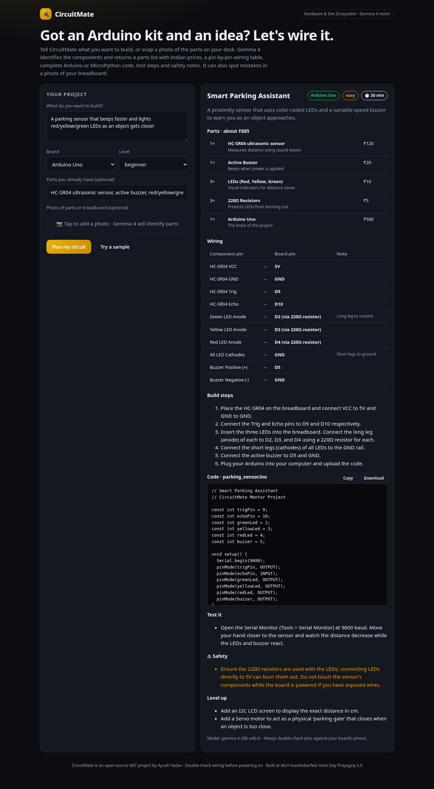

# 🔌 CircuitMate

**From hardware idea to a wired-up Arduino in minutes.** Describe what you want to build, or snap a photo of the parts on your desk. **Google Gemma 4** identifies the components and returns a parts list with approximate ₹ prices, a pin-by-pin wiring table, complete Arduino C++ or MicroPython code, test steps and safety notes. Upload a breadboard photo and it points out wiring mistakes.



## Why
Students get Arduino kits at events like this one, then get stuck on "which pin goes where?" and on code that won't compile. Tutorials rarely match the parts you actually have. CircuitMate starts from *your* idea, *your* board and *your* parts.

## Prize track
- **Hardware & Dev Ecosystem Track** of Hack Day Prayagraj Edition 3.0: open-source embedded systems, developer tooling and API integrations.
- **Best Use of Gemma 4**: it uses multimodal input (a photo of the parts) and is a focused learning tool.

## Features
- Boards: Arduino Uno, Arduino Nano, ESP32, ESP8266 (NodeMCU), Raspberry Pi Pico and Pico W. MicroPython is used for the Pico boards.
- Levels: beginner, intermediate, advanced.
- 📷 Optional photo of parts or breadboard, with a "Seen in your photo" list and photo feedback.
- Parts with quantities and approximate INR prices, plus an estimated total.
- A wiring table with real pin names, and 3.3 V vs 5 V and resistor reminders.
- Code you can copy or download as `.ino` / `main.py`, with the required libraries listed.
- Test steps (for example Serial Monitor), safety notes and upgrade ideas.

## Run locally
```bash
git clone https://github.com/ayush8620/circuitmate && cd circuitmate
cp .env.example .env
export GEMINI_API_KEY=your_key     # free: https://aistudio.google.com/apikey
node server.js                     # http://localhost:3000 (Node 18+, no npm install)
```
API: `POST /api/plan {"idea":"...","board":"ESP32","level":"beginner","parts":"...","image":"data:image/jpeg;base64,..."}`

## Deploy (free)
Import the repo on [Vercel](https://vercel.com/new) (preset "Other"), set `GEMINI_API_KEY`, and deploy.

## Tech
- Vanilla HTML/CSS/JS with zero dependencies, and one Vercel serverless function.
- **Google Gemma 4** (`gemma-4-31b-it` and `gemma-4-26b-a4b-it` in parallel with retries) via the Gemini API with image `inline_data`.

| Path | What |
|---|---|
| `api/plan.js` | circuit planning endpoint |
| `api/_gemma.js` | Gemma 4 client |
| `index.html`, `style.css`, `app.js` | UI |
| `server.js` | local dev server |

## Safety
Always check pins against your board's official pinout before powering on, and never work on mains (230 V) circuits without supervision. AI output can be wrong.

## License
[MIT](LICENSE) © 2026 Ayush Yadav. Built at MLH Hacktoberfest Hack Day Prayagraj × WikiClub Tech UIT (Edition 3.0).
